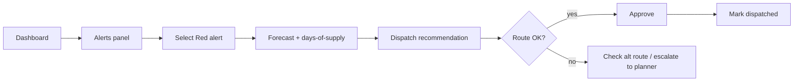
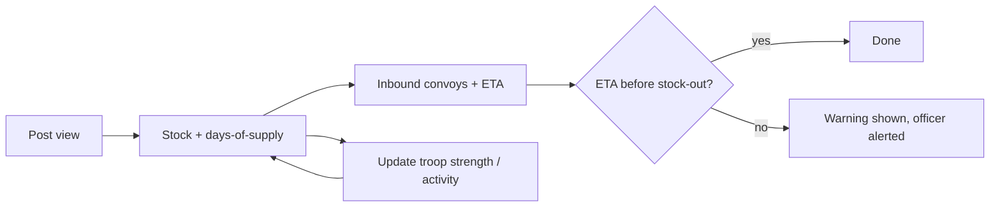
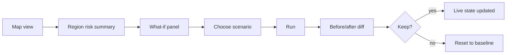
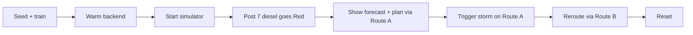
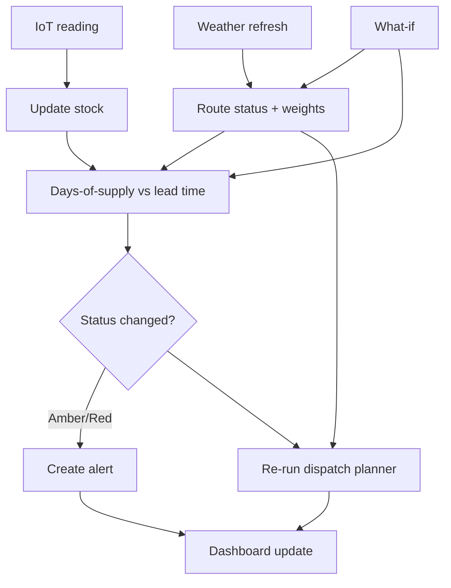

# User Flows

Four human users plus the automated system loop. FR references point to [PRD.md](PRD.md).

---

## 1. Depot Logistics Officer — "What do I send, where, when?"

1. Opens the **Command Dashboard**.
2. Scans the **Alerts panel** (sorted Red → Amber, then by days-of-supply).
3. Clicks a Red alert, e.g. *"Post 7 — Diesel — 4 days of supply"*.
4. Sees the **forecast chart** (history + next 14 days) and the explanation line. (FR-1, FR-5)
5. Opens the linked **dispatch recommendation**: qty, vehicle, origin depot, route, depart-by, ETA, "arrives before stock-out ✔/✘". (FR-19)
6. Hovers the route on the map to check status and risk score. (FR-11, FR-13)
7. Clicks **Approve**, then later **Mark dispatched**. (FR-20)
8. Alert stays open until a stock reading confirms replenishment.

---

## 2. Forward Post Commander — "Will supplies arrive before I run out?"

1. Opens the **Post view** for their post. (FR-25)
2. Sees each item with status colour and days-of-supply.
3. Sees **inbound convoys**: item, qty, ETA, route status/risk.
4. If an ETA is later than the stock-out date (shown in red), sees the warning.
5. Optionally updates **troop strength / activity level** (e.g. extra patrols) → forecast recalculates.
6. Returns to the dashboard or exits.

---

## 3. Senior Planner — "Where is the region at risk, and what if…?"

1. Opens the **Map view**: posts coloured by worst stock status, routes by open/degraded/closed. (FR-10, FR-11)
2. Reads the summary strip: # Red posts, # closed routes, # pending dispatches.
3. Opens the **What-if panel**. (FR-23)
4. Picks a scenario: close Route A / snowstorm over a region / troop surge at Post X.
5. Clicks **Run** → forecast, alerts and dispatch plan recompute.
6. Reviews the **before/after diff**: rerouted convoys, new Red posts, changed ETAs. (FR-24)
7. Either keeps the scenario (it's now the live state) or clicks **Reset**.

---

## 4. Demo Operator / Admin — the 2-minute judge demo

Setup (before judges arrive):
1. Seed synthetic data and train the model.
2. Ping the backend to warm it up.
3. Start the IoT simulator.

Live script:
1. Show dashboard: all Green/Amber, forecast MAE/MAPE visible. (Success metric 1)
2. Simulator drains diesel at Post 7 → Amber, then Red alert fires on its own. (Metric 2)
3. Click the alert → forecast "Post 7 runs out of diesel in 4 days" → dispatch via Route A.
4. Trigger **snowstorm** over Route A in What-if → route turns closed on the map.
5. Plan updates live: convoy rerouted via Route B, new ETA, still before stock-out. (Metric 3)
6. Trace complete: forecast → alert → route → vehicle → ETA. (Metric 4, < 2 min)
7. Reset.

---

## 5. System (automated) loop

1. Reading arrives at `POST /readings` → validated, stored, `stock_levels` updated.
2. Days-of-supply recomputed from the latest forecast.
3. Status compared with lead time (from current best route ETA) and safety stock → Green/Amber/Red.
4. On a transition to Amber/Red, an alert is created (de-duplicated).
5. Weather refresh (scheduled) → route edge status and weights updated.
6. Dispatch planner reruns when stock status, route status or what-if state changes.
7. Dashboard picks up changes (realtime/polling ≤ 5 s).

